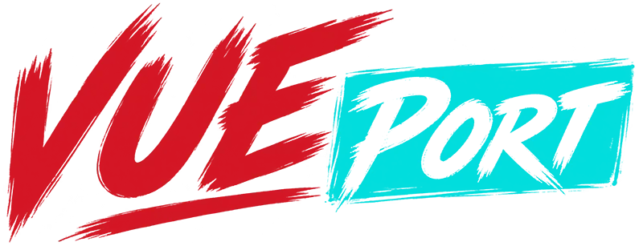

# VUEPort

VUEPort (read "viewport") is a modern, accurate and easy-to-use Virtual Boy emulator for your browser, desktop, mobile and VR device, built around the [Shrooms-VB](https://git.virtual-boy.com/PVB/shrooms-vb-core).

You can play it right now at [play.vueport.net](https://play.vueport.net). More information on [vueport.net](https://www.vueport.net).

## Features

### Accurate

Up to date with the latest Virtual Boy hardware research, thanks to the shrooms-vb emulation core. CPU pipeline, VIP drawing and timing are calibrated against measurements on real hardware.

### Runs Everywhere

Play instantly in your browser, on your phone with an on-screen controller, or grab a native build for Windows, macOS or Linux.

### VR

True stereoscopic 3D on a giant screen in WebXR headsets like the Meta Quest, from the web or the desktop version. VUEPort Desktop can share a game with a headset in the same network.

### VB Color

Fully supports VB Color, a fictional, fully backwards compatible color successor to the Virtual Boy, that has been conceived as a by-product of this emulator.

### Game Library

Your ROM folders, matched against Planet VB's catalog for titles, box art and details, plus Planet VB's homebrew archive on the same shelves. Browse as a cover wall, a list or a coverflow of boxes you can turn around.

### Save States and Save Slots

A visual browser of all save states, automatic states on a timer, and Suspend and Resume to pick a game up where you left it. Multiple cartridge save slots per game.

### Speed Control

Rewind with a filmstrip of the last moments, seekable both ways, plus fast-forward, slow motion and frame advance.

### Controls

Remap Virtual Boy buttons and emulator hotkeys to keyboard or game controller, with per-device controller profiles, rumble, turbo and macros. On a phone, an on-screen controller with a layout editor.

### Display

Left or right eye, anaglyph, side-by-side, CyberScope, and horizontal or vertical line interlacing for passive 3D displays. Adjustable 3D depth, custom palettes, and frame blending, which emulates persistence of vision and reproduces flicker-based tricks like HiColor. Immersion mode extends the picture beyond the screen with an Ambilight-style glow.

### Patches and Cheats

Patches are applied on the fly without modifying the ROM, with a bundled library per game: translations, save support, rumble, bug fixes and VB Color colorizations. IPS, UPS, BPS and BSDiff. A cheat engine with `.cht` files, a ready-to-use collection of cheats and a memory scanner to find your own.

### Link Cable

Two players over an emulated link cable, between two windows, deterministic and in lockstep.

### Rumble Pack and ESSound

Connect a RetroOnyx Virtual Boy Rumble Pack via USB, in VUEPort Desktop or Chromium-based browsers. ESSound plays high-quality audio tracks beside the ROM, as otherwise only flash carts like the MrCart 128 can.

### RetroAchievements

Achievements, hardcore mode and leaderboards.

### Developer Tools

A dockable debug mode with memory, registers, disassembly with breakpoints and source lines, a CPU profiler, ELF/DWARF symbols, VIP, VSU and VB Color inspectors. The screen inspector tells you what drew any pixel.

### VUEngine Studio

VUEPort is built right into [VUEngine Studio](https://www.vuengine.dev), with dedicated inspectors for VUEngine's actors and memory pools, and source-level debugging with breakpoints and stepping.

### Headless Mode

`vbprobe` and `VUEPort --probe-cli` let scripts, CI pipelines and AI agents run, inspect and fork the machine. See [packages/probe/PROBE.md](packages/probe/PROBE.md).

### Automatic Updates

The desktop app finds, downloads and installs signed updates. Builds without a code-signing certificate only announce a new version and open its download page.

### Languages

The full application is available in 13 languages: English, German, Spanish, French, Italian, Japanese, Czech, Hungarian, Polish, Portuguese (Brazil and Portugal), Russian, and Simplified Chinese.

## Packages

| Package | |
| --- | --- |
| [`packages/core`](packages/core) | The emulator itself: worker, panels, React components, translations and the probe. Host-agnostic, everything platform-specific goes through `src/common/emulator-host.ts`. Also consumed by VUEngine Studio. |
| [`packages/web`](packages/web) | The standalone browser build |
| [`packages/desktop`](packages/desktop) | The desktop app, built with [Tauri](https://tauri.app). See its [README](packages/desktop/README.md). |
| [`packages/probe`](packages/probe) | `vbprobe`, the probe on the command line. See its [README](packages/probe/README.md). |
| [`packages/server`](packages/server) | A small PHP relay at `api.vueport.net` for RetroAchievements, Planet VB and Network Shares. See its [README](packages/server/README.md). |

## Building

```sh
yarn install
yarn build
```

Run the web app on a dev server at `:5173`:

```sh
yarn workspace vueport-web start
```

`packages/web/dist` is the whole deployable: static files, no server code. The dev server builds into `dist-dev` instead.

> **Note**: The web build bundles the core from its sources, but the worker from `packages/core/lib`. Run `yarn build` after changing the core or switching branches, or the worker is stale.

The desktop app needs [Rust](https://rustup.rs), [CMake](https://cmake.org) and the platform's webview development packages:

```sh
yarn workspace vueport-desktop dev        # run it
yarn workspace vueport-desktop bundle     # installers
```

The emulator core and the RetroAchievements engine are committed as prebuilt WebAssembly. See [packages/core/wasm](packages/core/wasm/README.md) to rebuild them.

## Tests

```sh
yarn workspace vueport-core test        # probes for everything that runs without a DOM
yarn workspace vueport-web test:ui      # the built page in a real browser, needs puppeteer
yarn workspace vueport-desktop test     # test:link, test:companions and test:rust drive the real app
yarn workspace vueport-server test      # URL building, then the relay end to end
```

> **Note**: The root `yarn test` currently stops at `vueport-web`, which has no `test` script. Run the four commands above instead.


## License

VUEPort is licensed under the [MIT License](LICENSE). This does not cover the Shrooms-VB core (`packages/core/wasm/shrooms`) and the bundled ROM patches, which belong to their respective authors.
